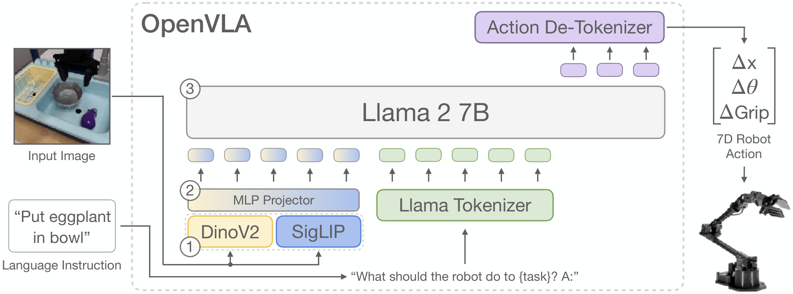
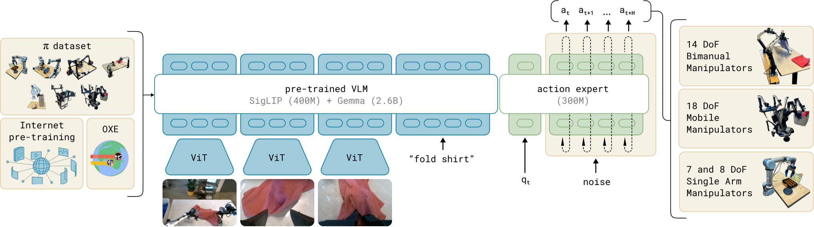
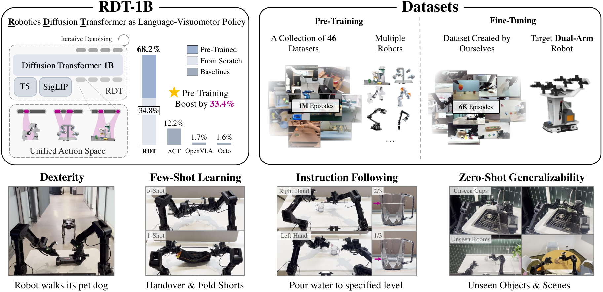
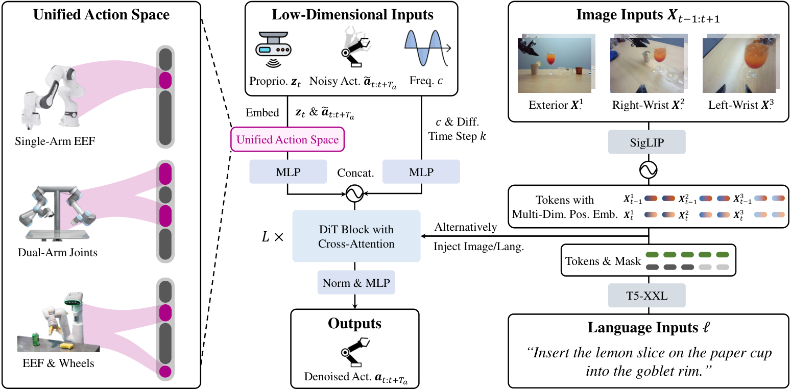
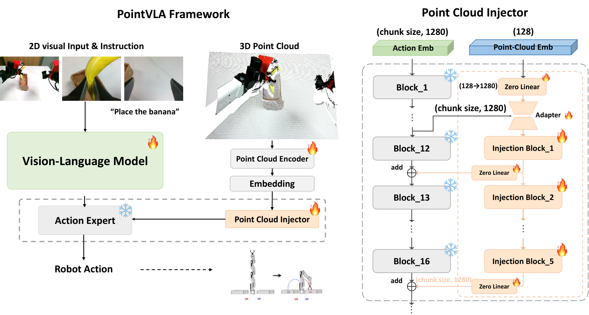
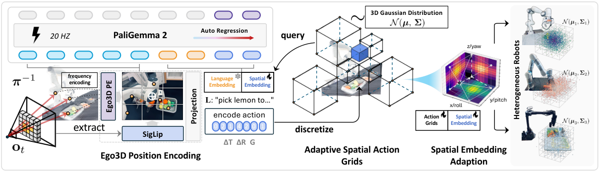
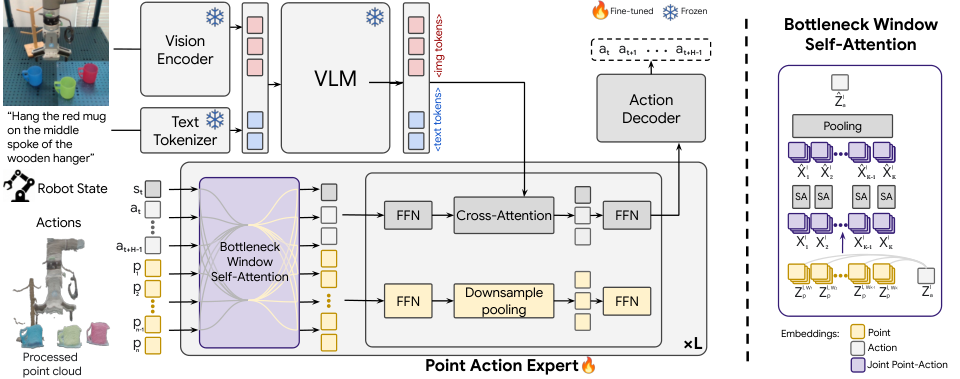
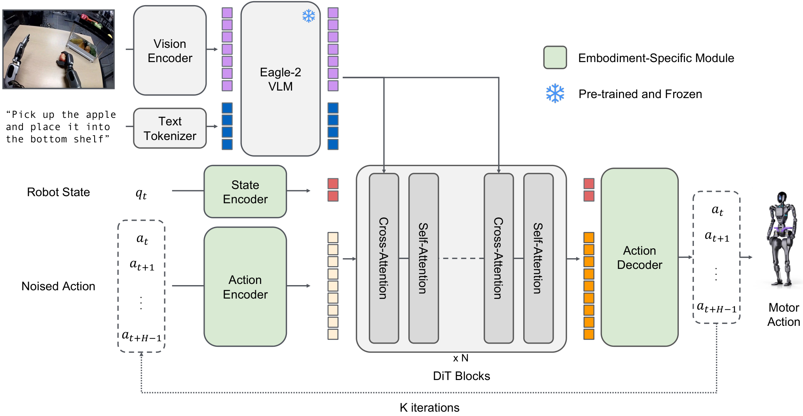

# VLA 文献调研

## 7 篇论文

| 论文 | 定位  |
| ------------ | ----- |
| OpenVLA      | 主流 2D 数据配方标本 |
| π0           | 范式转折：离散 token → 连续动作生成 |
| RDT-1B       | 原生双臂扩散基础模型 |
| RoboTwin 2.0 | 双臂评测基准 |
| PointVLA     | 「3D 注入式」代表 |
| SpatialVLA   | 「3D 编码注入」代表 |
| PointACT     | 「3D 原生架构」代表 |

### 主流vla论文

#### 数据组成

| 组成 | 原始记录通常是什么 | 模型侧怎么用 |
| -- | --- | --- |
| 视觉（RGB 图像） | 一帧彩色图像 `H×W×3`、 | 单路常写作 `[B,C,H,W]`；多视角可写作 `[B,V,C,H,W]`，其中 `B` 是批量、`V` 是相机路数，具体布局依模型实现而变 |
| 语言指令 | 一段字符串 | 文本 token |
| 本体状态（proprioception） | 机器人自身传感读数，如关节位置 `qpos`、关节速度 `qvel`、夹爪开合量，或末端位姿 | 按机器人/模型定义拼成状态向量并归一化；例如 `q=[q1,...,q7]`、`gripper=0.4`。π0、RDT 会使用状态条件；OpenVLA 的标准输入不包含本体状态 |
| 动作标签 | 示教器/控制器在每个时间步记录的机器人命令或目标状态 | 可能是关节目标、末端位姿/增量和夹爪命令 |

```text
instruction: "pick up the apple"
image_t:     RGB 图像，H×W×3，
state_t:     [q1, q2, ..., q7, gripper]
action_t:    [Δx, Δy, Δz, Δroll, Δpitch, Δyaw, gripper]
```

**7 维增量动作**

| 维度 | 常见含义 | 例如 |
| -- | -- | --- |
| `Δx, Δy, Δz` | 末端执行器沿选定坐标系三个轴的平移增量，常用米 | `Δx=+0.01` 表示沿 x 方向移动 1 cm |
| `Δroll, Δpitch, Δyaw` | 末端姿态绕三个轴的旋转增量；示例可用弧度 | `Δyaw=+0.05` 表示小幅转动 |
| `gripper` | 夹爪开合命令，常见为归一化比例或开/关值 | `0`/`1`  |

```text
相机画面 + 语言指令 +（可选）机器人状态
                  ↓
                 VLA
                  ↓
     一个动作，或一小段未来动作
                  ↓
     机器人执行后再次观察环境
```


#### OpenVLA（2024，Stanford 等，arXiv 2406.09246）

会用动作 token 回答的 VLM



**256 个 bin**：每个动作维度分别有 256 档。例如，沿 x 轴移动有 256 个候选档位，夹爪也有自己的 256 个候选档位。训练时，每一维按训练数据 `1%–99%` 分位数范围均匀量化。模型逐个预测这些离散动作 token，再逐维解码回数值。因此它仍然是在控制连续世界里的机器人，只是模型内部先用有限档位表达动作。

使用 Open X-Embodiment 数据中的约 97 万条机器人演示训练模型。训练从预训练的 Prismatic-7B 视觉语言模型出发，再以机器人演示微调，使已有视觉和语言能力与动作预测对齐。


#### π0（2024-10，Physical Intelligence，arXiv 2410.24164）

π0 ：VLM 加一个专门的 action expert



VLM 先提供场景和任务上下文，动作专家把上下文转换为手臂、末端执行器和夹爪的运动。

Flow matching：模型学习一个“该往哪个方向修正”的速度场；推理时从带噪声的动作序列出发，反复沿着这个速度场更新，最后得到符合图像、指令和状态的一段连续动作。π0 一次产生的是未来一小段动作action chunk；论文报告其控制频率最高可达 50Hz。

#### RDT-1B（2024-10，清华 THU-ML，arXiv 2410.07864）



输入：视觉/指令/（本体状态->统一动作空间 128 维向量）/带噪动作序列
输出：动作序列



统一动作空间：动作按物理含义组织到统一表示中，让跨机器人的相应字段尽量表达同类物理量；某个机器人没有的维度用约定方式补齐，并用机器人形态信息区分数据来源。

模型先得到一段带噪声的候选动作，再经过扩散去噪逐步修正为连续动作块。动作块长度是 64；统一动作表示采用定长向量（动作空间 128 维）。 64 时间步数，128 每个时间步动作向量的维数


### 使用点云 / 3D 数据的 VLA

点云数据来源：

RGB-D 深度相机: 相机同时给彩色图 `I(u,v)` 和深度图 `Z(u,v)`。利用相机内参把每个有效深度像素反投影为相机坐标系中的三维点

双目立体相机：左右相机从略有间距的位置同时拍摄；先匹配同一物体在左右图像中的位置，得到视差 `d`。已知焦距 `f` 和基线 `B` 后，以 `Z=fB/d` 估计深度，再按内参反投影

LiDAR 激光雷达： 传感器发射激光并测量回波距离；每束射线结合水平/垂直角度，将距离从球坐标换算到 XYZ，`(x,y,z,intensity)`

单目 RGB + 深度估计： 只有普通 RGB 时，用预训练单目深度网络为像素预测深度，再用内参将深度图反投影为点云。

#### PointVLA（IEEE RA-L 2025，arXiv 2503.07511）

双系统，扩散生成



冻结原有的动作专家，只训练一个轻量 3D 特征注入模块；

Injection Block：接受当前动作 token (chunk size,1280) 和映射得到的 3D 点云特征(chunk size,1280) ，是把对齐后的 3D 信息变成一份动作隐藏特征的修正量

依据去掉某些层对输出影响不大，最多可以连续去除五层（分析实验）


#### SpatialVLA（RSS 2025，arXiv 2501.15830）

类似 OpenVLA



Ego3D 位置编码：用单目深度估计得到深度图，按相机内参反投影成以相机为原点的 3D 坐标,经正弦编码 + MLP 后逐 token 加到 SigLIP 视觉特征上

自适应离散动作网格：把 7 维末端动作拆开,平移转成极坐标 (φ, θ, r),然后按数据分布拟合高斯、用等概率分箱(每箱概率 1/M)切成网格,得到一套空间动作 token(论文配置约 8194 个 token:平移 4096 + 旋转 ~4096 + 夹爪 2)加进词表,用自回归方式预测。

推理时不需要深度传感器

#### PointACT（RSS 2026，arXiv 2605.21414）

双系统，回归



动作专家去吃 3d 点云

点云数据编码成 token ，分 k 个窗口（PTv3，空间序列化，邻近点合并 token，粗细尺度），动作 token 在各窗口做自注意力，最后 average pooling 回来，得到融合点云信息的动作 token，逐层重复（点云 token 池化为更粗粒度 ），再和 VLM 输出 embedding 做交叉注意力。


---

### 动作生成机制

#### 离散 token 自回归

OpenVLA ：每个动作维度分别划分为 256 个 bin，逐 token 预测。

#### Diffusion

RDT: 用 DiT 产生连续动作块(`64×128`)

#### Flow matching

π0 :将预训练 VLM 的视觉/语言表征与 flow matching 动作专家结合，预测连续动作块；论文报告的代表设置是 50 步动作块、面向最高约 50Hz 控制。

#### latent action

LAPA: 通过带动作的视频学习一个 `z_t` 来学习潜在的动作，学习用 `z_t` 和当前帧重建未来帧，然后再微调机器人让其根据 `z_t` 生成动作。

---

### Benchmark

#### RoboTwin 2.0（CVPR 2025，arXiv 2506.18088）

| 内容       | RoboTwin 2.0 的设置                            |
| ---------- | ---------------------------------------------- |
| 任务       | 50 个双臂操作任务                              |
| 机器人构型 | 5 种：Aloha-AgileX、ARX-X5、Piper、Franka、UR5 |
| 物体库     | RoboTwin-OD 包含 731 个物体实例、147 个类别    |
| 数据规模   | 官方发布超过 100,000 条专家轨迹                |

这里面数据具体什么样我还没看

### FMCW

原始 4D 点云 (x,y,z,v) + 逐点时间戳 t

径向速度 v，多帧点云是不是可以拿到横向运动信息?

### GR00T N1.7



CategorySpecificMLP：为每种机器人本体维护独立的 MLP 权重，状态输入和动作输出这些靠近物理本体的映射层不完全共享，根据 embodiment_id 选择不同参数

AlternateVLDiT：在 DiT 交叉注意力层中，交替关注图像 token 和文本 token；奇数层做动作Token内部自注意力，偶数层做交叉注意力；偶数层里又根据attend_text_every_n_blocks 决定读取非图像Token还是图像Token。