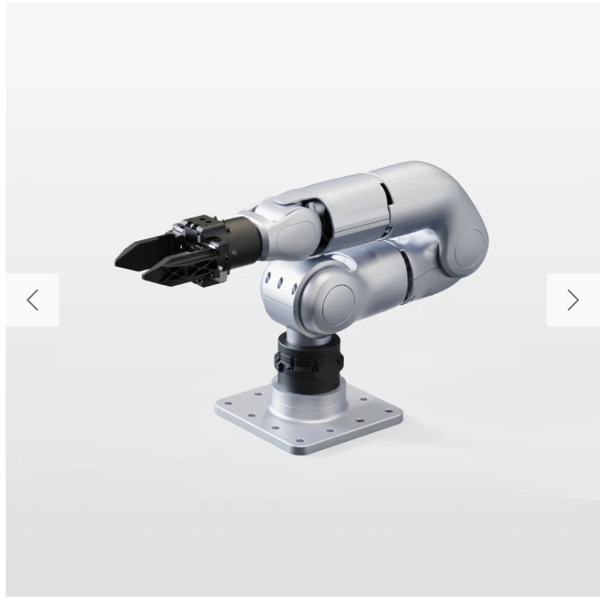
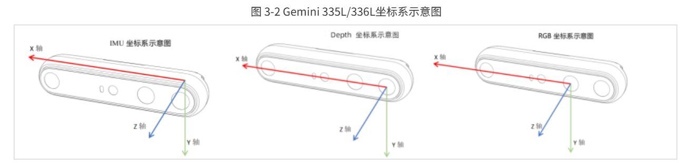
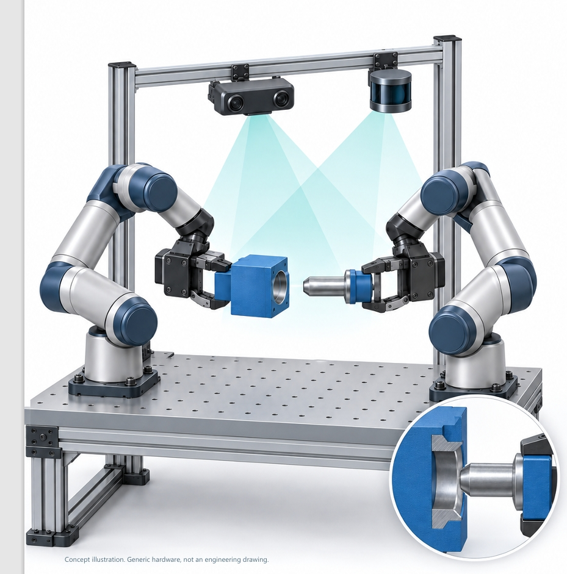

# 调研

## 项目信息

### 项目硬件

+ 两台七轴 Unitree R1-7a 机械臂

+ Orbbec Gemini 335 相机

+ FMCW 激光雷达

原理：用激光连续发射一段频率不断变化（匀速）的光波，并观察目标反射回来的光；回波晚多少决定距离；回波频率因运动偏移多少决定径向速度。

速度向量在视线方向上的分量

(x, y, z, vr, t)

+ 腕部六维力/力矩传感器

  3 个线性力与3个力矩:
  + 线性力：Fx（X 轴，左右方向）、Fy（Y 轴，前后方向）、Fz（Z 轴，上下方向）
  + 力矩：Mx（绕 X 轴旋转）、My（绕 Y 轴旋转）、Mz（绕 Z 轴旋转）

+ PICO 4 Ultra 示教控制器

### 任务目标

初始插销直径为 10 mm，插入深度为 20 mm。起始直径间隙为 1.0 mm；主任务采用 0.5 mm 间隙，并设置 0.5 mm × 45° 的入口倒角。直径间隙指孔径减去插销直径

> 也就是孔直径 11 mm，主任务就是 10.5 mm

数据：两种相机模式合计计划获得 1,720 条合格示教轨迹；按 75% 接受率估算，约需尝试 2,300 次，数据采集约 115–230 小时。

在主任务中实现至少 90% 的首次尝试成功率。另以 0.2 mm 间隙测试能力极限。

> 也就是孔直径 10.2 mm

### 相关研究

#### Rho: A Foundation for Efficiently Adaptable VLA Models

两台 Franka FR3 七轴机械臂协作，一臂稳定插座/排插组件，另一臂抓取插头、调整插头方向，再插入插座。
三路 RGB 图像，固定相机加两只腕部相机。插入任务中，Rho 为 24/30 ，GR00T N1.7 为 18/30（150 条示教、50k 步任务微调） ，π0.5 为 12/30 。

#### Baxter

两条 Baxter 七自由度机械臂分别持有待装配件，完成圆形和方形的销孔插装；腕部安装六维力/力矩传感器

论文报告最大间隙为 0.5 mm ，孔长 30 mm ；力/力矩约 20 Hz 采样。

#### AWS/WIRobotics

ALLEX 人形机器人（GR00T N1.7）：“抓起电钻并驱动”和“将电钻对准螺栓”：抓取任务 100%，对齐为 50%。

#### SimplerEnv（GR00T N1.7）

Fractal：Google Robot 单臂任务

pick_object：94%
move_near：100%

### 任务

[lerobot/act_aloha_sim_insertion_human](https://www.modelscope.cn/models/lerobot/act_aloha_sim_insertion_human)

ACT训练 100000 步 ，在该仿真任务上评测 500 个 episode，成功率 20.6% ；
