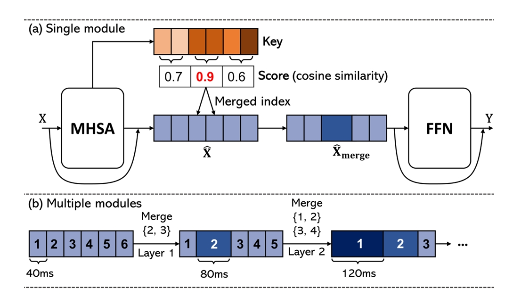
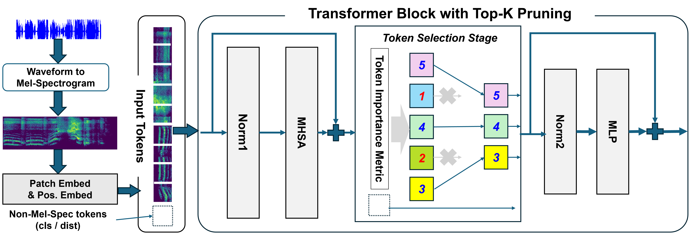
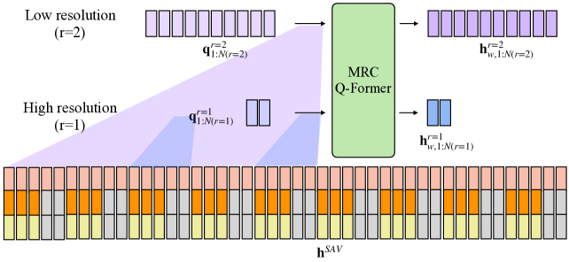
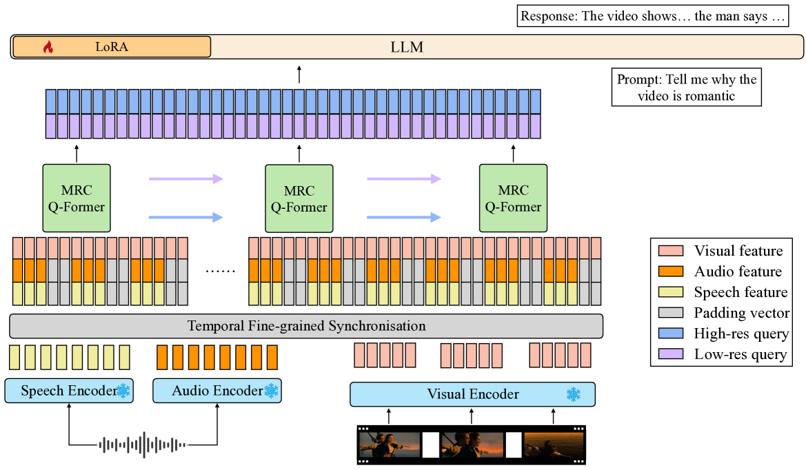
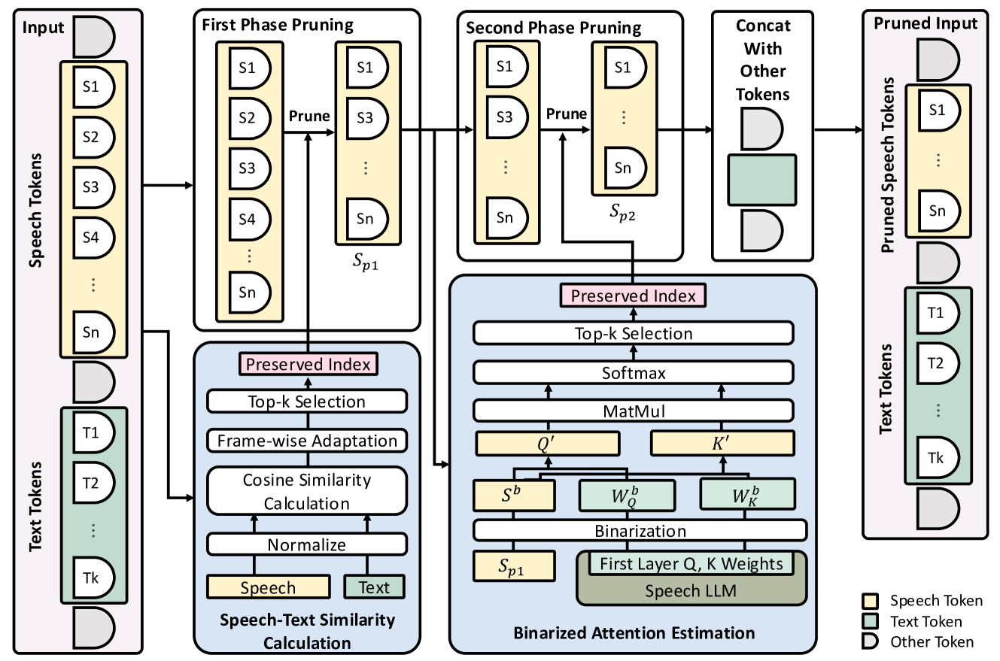
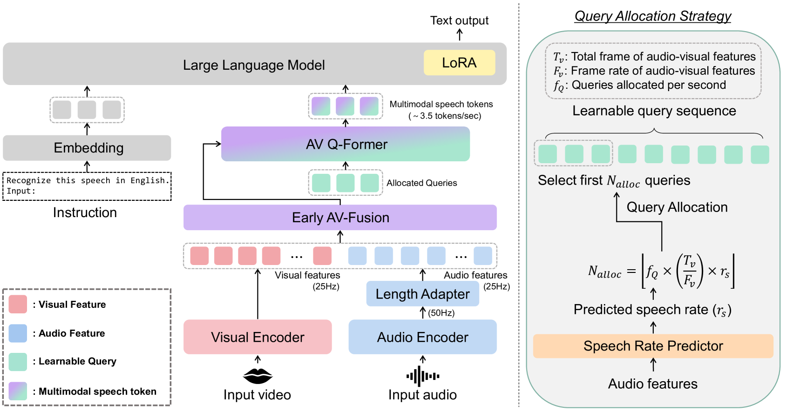
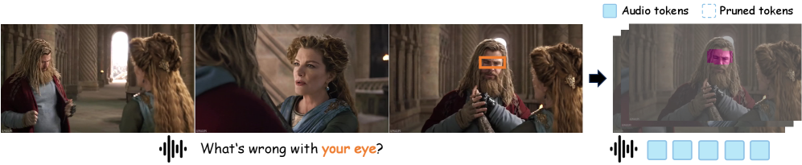
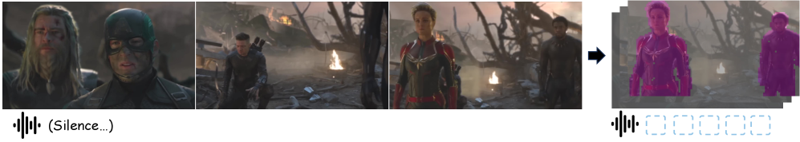
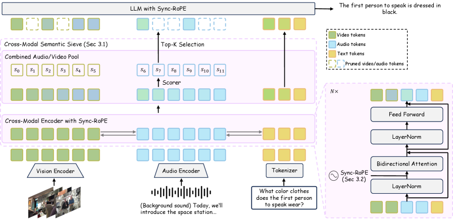
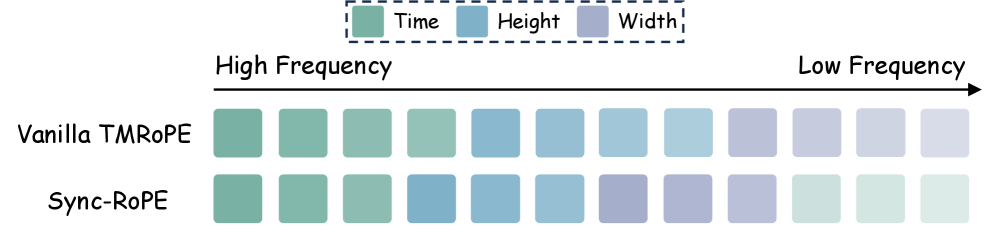

## Record

### 2025-12-29 - 2025-12-31

找了一些和音频 token 压缩相关的论文：

+ Token Stacking：将多个连续的 token 沿着 token 的隐藏维度进行堆叠，需要 MLP 重新调整维度。eg. SLAM-ASR、LLaMA-Omni、Llama-AVSR

+ Pooling: Qwen2-audio 和 Qwen2.5-Omni 就是步长为 2 的池化；

+ Temporal Convolution：可学习；在时间维度上应用 1 维卷积减少 token 数量。 eg. [SpeechVerse](https://arxiv.org/abs/2405.08295)、[OSUM](https://arxiv.org/abs/2501.13306)、[LUCY](https://arxiv.org/abs/2501.16327)

+ **Similarity-based audio-centric Compression**: [A-ToMe](https://arxiv.org/abs/2306.16009) 在 MHSA 和 FFN 中间插入一个 token 合并模块，利用自注意力计算中使用的 key values 来计算相邻 token 之间的余弦相似度，合并具有高余弦相似度的相邻音频 token（平均值）

    

    每三层嵌入一次 A-ToMe，具体在层 2、5、8、11、14 和 17，每层合并比例的上限为 50%

    在语音信息密集的地方，token密度仍然较高，而在语音信息稀疏或冗余的地方，token密度显著降低。

+ Attention-based audio-centric Compression:

    Attention in Encoder: [Token Pruning in Audio Transformers](https://arxiv.org/abs/2504.01690) :TopK token 剪枝, 仅保留按注意力分数幅度排名前 K 的音频 token

    

+ Query-based audio-centric Compression:

    + Token Distillation: 利用可学习的查询 Token 将全面的音频信息蒸馏为紧凑的固定长度表示; eg. [SALMONN 系列](https://arxiv.org/html/2406.15704v1)

    > 由于 longvale 数据集音频存在指导时间边界的作用, QFomer 压缩会丢失细粒度的时间信息？

    

    MRC Q-Former: 从不同时间分辨率的多长度输入中提取视听特征。详细结构如图所示。音频和视频帧在每个视频帧（即每 0.5 秒， 2fps）处同步，通过零填充使序列具有相同的长度（256，25）

    同步输入流在多个不同分辨率下被划分为固定长度的窗口，例如每隔 1、5 或 10 秒

    高分辨率滑动窗口覆盖 k = 5每个窗口覆盖 5 帧，使用两个查询向量；低分辨率 Q-Former 覆盖 k = 25，使用 10 个查询向量。这样对于更小的时间窗口，关注局部关键特征，对于长时间窗口，关注更多的特征。（有点像 slowfast 高分辨率低帧率，低分辨率高帧率）

    

    在将所有分辨率的输出查询向量发送至 LLM 之前，会使用一个投影层将它们组合起来

+ **Cross-Modal Selection**: [Speechprune](https://arxiv.org/abs/2412.12009): 这是通过计算基于余弦相似性的跨模态相似度矩阵(音频-文本相关性)来实现的，然后用这个矩阵指导音频标记的压缩。(时序信息能在文本中体现出来吗? seg_captioning 和 grounding 的话应该是可以;但是单纯 captioning 的话..)

    

    检查语音和文本 token 嵌入之间的余弦相似度来移除语义上不相关的语音 token，然后还有一次注意力剪枝, 用第一层 Transformer 提供的注意力分数对音频 token 进行 top k 剪枝

    没有源码


### 2025-01-04

两篇比较新的paper

[MMS-LLaMA](https://arxiv.org/abs/2503.11315v2): AV QFormer 预先合并视觉音频模态,然后接 QFormer; 感觉时间上信息损失多, 和 benchmark 可能匹配性不好

这篇和 SALMONN 都用了QFormer，不过不同的地方挺多



+ 首先是音视频 token 在前期融合（三种视听融合策略，拼接，逐元素求和，交叉注意力融合），不过这里有个比较变态的 25 fps，可能是这里因为只用到唇部图像（96*96），

+ 使用一个动态调整的查询数量：根据视听特征序列的长度动态分配

+ 训练了一个语音速率预测器，也用于控制查询数，语速快信息多，需要更多的查询


还有一篇比较新的，里面已经实现了动态选择 Visual/Audio token 的压缩比这种思路

[EchoingPixels: Cross-Modal Adaptive Token Reduction for Efficient Audio-Visual LLMs](https://arxiv.org/abs/2512.10324v1)


跨模态编码器, 可以借鉴的是同时段的音视频 token 基于重要性分别打分, 然后分配不同的数目, 可以结合 top k 剪枝


由于音频和视频流具有独特且相互影响的信息密度，对每种模态应用静态、预设的压缩预算是不理想的，如何在联合音频-视频流上执行标记减少仍然是一个问题。



音频引导 LLM 把视觉集中注意到 eye 上面，LLM 分配视觉



环境无声音，引导 LLM 集中于视觉信息

token 压缩由跨模态交互来指导



在 Qwen2.5-Omni 系列上验证了 EchoingPixels，实验表明，EchoingPixels 仅使用 5-20% 的原始 token 即可达到与强基线相当的性能

两个重要思路：

+ Cross-Modal Semantic Sieve：在整体跨模态的上下文中评估每个 token

    原因：

    1. 孤立压缩各模态 token 方法忽视了跨模态协同效应
    2. 因果注意力解码器进行跨模态融合这种单向流，防止了早期的视频/音频 token 受到后期线索的影响，但是存在比如后面的视频内容对应前面的音频内容这样的状况，反之亦然

    + Cross-Modal Encoder

        + 输入序列的整合：所有输入模态的 token 序列进行拼接。

            视频 token $T_v \in R^{L_v \times D}$、音频 token $T_a \in R^{L_a \times D}$ 和文本指令 token $T_t \in R^{L_t \times D}$。

            拼接后的序列表示为 $T = \text{Concat}(T_v, T_a, T_t)$。

        + 利用预训练 AV-LLM 的能力：复制预训练 LLM 的前 N 个解码器层，并将其作为轻量级的 Cross-Modal Encoder $E(\cdot)$ 进行训练，以增强上下文感知能力。

            双向注意力机制: 序列中较早的 token（例如视频中的早期事件）可以关注较晚的 token（例如音频中的后期事件），反之亦然。

        通过这个过程，Cross-Modal Encoder 产生一个整合的表示 $T'$，其中每个 token 的表示都通过音频-视觉流中的所有其他 token 进行了充分的上下文化：

            $$T' = \text{Concat}(T'_v, T'_a, T'_t) = E(\text{Concat}(T_v, T_a, T_t))$$

    + Adaptive Token Selection

        + Scorer：一个简单的两层 MLP

            将池中的每个音视频 token $T'_i$ 映射到一个标量重要性分数 $s_i$**。这个分数 $s_i$ 量化了该 token 在整个跨模态上下文中的语义价值和信息量。

            $s_i = \text{MLP}(T'_i)$，其中 $i$ 的范围涵盖所有视频和音频 token (从 $1$ 到 $L_v + L_a$)。

        + Top-K Selection（Top-K 选择）

            在计算出所有音视频 token 的重要性分数 $s_i$ 后，根据一个预设的**总 token 预算比例 $p$** 来确定要保留的 token 数量 $k$。

            $k = p \cdot (L_v + L_a)$

            从所有音视频 token 中**选择得分最高的 $k$ 个 token**。这些被选中的 token 构成了压缩后的音视频序列 $T_{comp}$,最终被送入 LLM 的是 $\text{Concat}(T_{\text{comp}}, T'_t)$。

        +  可训练性与 Straight-Through Estimator (STE)：Top-K 操作是一个离散且不可微分的操作, 因此采用了 Straight-Through Estimator (STE) ，这使得最终损失的梯度可以“直通” Top-K 操作，反向传播回 Scorer 的得分 $s_i$。因此，MLP 评分器能够学习如何为那些对最终任务更有益的 token 分配更高的分数。


+ Sync-RoPE

引入的两个问题：

1.  无序的双向注意力：不强制保留严格的时间顺序信息，更侧重于全局依赖而非局部顺序。

2.  稀疏且不规则时间序列：只保留了少数“重要”的 token，一个高度稀疏的序列，其中相邻保留的 token 之间存在较大的、不规则的时间间隔。


TM-RoPE：它将 token 的特征维度 $d$ 将维度 d 依次划分为三个连续部分，以表示时序 t 、视频高度 h 和宽度 w ，即 [t,h,w]，时间 $t$ 被分配给最小索引的通道，对应最高的旋转频率。

```json
// TMRoPE
"mrope_section": [16,24,24],
// Sync-RoPE
"rope_section": [18, 18, 18, 10], // 经实验选择
```



因为稀疏序列的时间间隔较大可能超过高频编码的变化周期，导致无法表示这种时间，不同的时间可能叠加到相似的编码上

把后面较大索引低旋转频率的通道分配给时间

将这种位置编码应用于 CS2 模块和整个 LLM 解码器 （how？）

#### 总结

感觉 EchoingPixels 这个做的已经挺完善了，在音视频直接融合上面，要做或者从音频出发？因为 LongVALE 的特点就是引入了音频影响事件边界，或者从音频 token 压缩入手去引导视频 token 的压缩？


### 2025-01-05 - 2025-01-06

+ new baseline：独立不相干的 视觉 token 压缩和音频 token 压缩

+ 2594：视频 token 压缩


